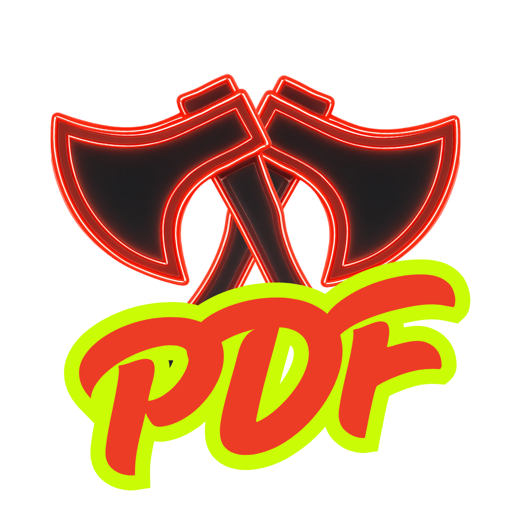
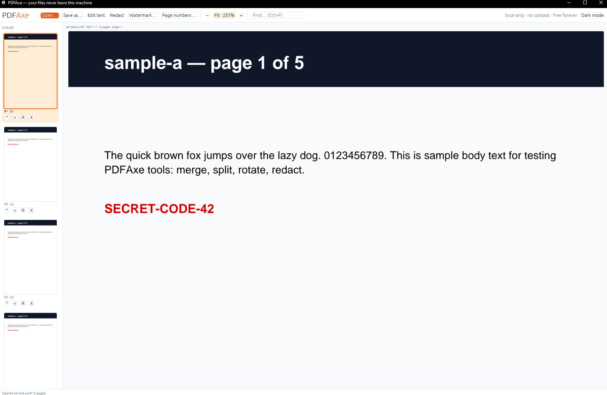

<p align="center">
  
</p>

<h1 align="center">PDFAxe</h1>

<p align="center"><b>Local, private PDF surgery.</b><br>
A native Windows PDF editor in 100% Rust — no uploads, no account, no telemetry.<br>
Architecturally incapable of seeing your files.</p>

<p align="center">
  <a href="https://pdfaxe.app"><b>pdfaxe.app</b></a>
</p>

<p align="center">
  <a href="https://github.com/LXBStudioLLC/pdfaxe/actions/workflows/ci.yml"></a>
  
  
  
  
</p>

---

<p align="center">
  
</p>

## Why

Every mainstream PDF tool wants your document on their server or your card on
their subscription. PDFAxe is the opposite bet:

- **Local only.** The app contains no network code. Files can't leave the
  machine because there is no road out.
- **Real text editing.** In-place edits keep the original font and position,
  with same-line reflow, paragraph re-wrap, and font re-embedding for glyphs
  the document never used.
- **Free forever.** AGPL-3.0 copyleft — the app and every fork stay open
  source. Businesses pay for deployment and update rollouts, never per seat.

## Operations

| # | Operation | Surface | Notes |
|---|---|---|---|
| 01 | `edit-text` | GUI · CLI | In-place: same font, same position; reflow + re-wrap + font re-embedding |
| 02 | `redact` | GUI · CLI | Raster burn — pixels destroyed. The burned page's original content, annotations, form fields and thumbnail leave the *file*, not just the page tree (object-level test); metadata and bookmarks to it go too |
| 03 | `merge` | CLI | Inheritable page attributes carried correctly; forms, bookmarks, attachments and metadata ride along |
| 04 | `extract` | CLI | Page ranges into new documents |
| 05 | `reorder` / `rotate` | GUI · CLI | One `assemble()` primitive under both |
| 06 | `watermark` | GUI · CLI | Diagonal translucent stamp, alpha honored |
| 07 | `page-numbers` | GUI · CLI | Templated — `"{page} / {total}"` |
| 08 | `images` → PDF | GUI · CLI | JPEG embedded as-is (lossless), PNG Flate |
| 09 | PDF → PNG | CLI | Pure-Rust raster export, page ranges |
| 10 | search | GUI | Ctrl+F across all pages with match stepping |
| 11 | `info` / `runs` | CLI | Object-level inspection, positioned text runs |
| 12 | Open-with | shell | `.pdf` association, drag-and-drop files or images |
| 13 | `scrub` | GUI · CLI | Strip the Info dictionary, XMP and app-private metadata |

Everything above is shipped and verified — see the
[verification log](docs/VERIFICATION.md) for exactly how.

## Install

Signed installers (≈11 MB) from **[Releases](https://github.com/LXBStudioLLC/pdfaxe/releases)**:
`PDFAxeSetup-vX.Y.Z.exe` for a normal install, or the per-user MSI for
Intune / SCCM fleet deployment — same app, same signature, either way.

- Signed **LXB Studio LLC** via Azure Trusted Signing
- SHA-256 checksum published with every release
- Windows 10 / 11, 64-bit · no admin rights needed (per-user install)
- No account, no license key, no telemetry — install and cut

## The CLI

The full engine is scriptable — the GUI and CLI ride identical code paths:

```console
$ pdfaxe info report.pdf
$ pdfaxe merge -o out.pdf a.pdf b.pdf
$ pdfaxe extract in.pdf -o part.pdf --pages "2-5"
$ pdfaxe edit-text in.pdf -o out.pdf --find "DRAFT" --replace "FINAL"
$ pdfaxe redact in.pdf -o out.pdf --page 1 --rect "38,635,130,22"
$ pdfaxe redact in.pdf -o out.pdf --pages "1-3" --rect "38,635,130,22" --keep-bookmarks
$ pdfaxe scrub in.pdf -o out.pdf
$ pdfaxe watermark in.pdf -o out.pdf --text "CONFIDENTIAL"
$ pdfaxe page-numbers in.pdf -o out.pdf --format "{page} / {total}"
$ pdfaxe images -o out.pdf scan1.jpg scan2.png
$ pdfaxe render in.pdf -o page.png --pages "1-3" --width 1200
```

## Built from — 100% Rust, zero C/C++ FFI

| Layer | Crate | Duty |
|---|---|---|
| Document surgery | [`lopdf`](https://crates.io/crates/lopdf) | Parse and rebuild PDF object graphs |
| Rasterization | [`hayro`](https://github.com/LaurenzV/hayro) | Pure-Rust PDF renderer, incl. its own JPEG2000/JBIG2 decoders |
| Interface | [`egui`](https://github.com/emilk/egui)/`eframe` | Immediate-mode native GUI — no browser, no Electron |
| Dialogs | [`rfd`](https://crates.io/crates/rfd) | Native Windows file dialogs |
| CLI | [`clap`](https://crates.io/crates/clap) | Scriptable surface + test harness |

Memory-safe from parse to pixel. The same core compiles to WASM — a future
web shell can wrap this exact engine.

## Workspace

```
crates/pdfaxe-core   engine: assemble() (merge/extract/reorder/rotate in one primitive,
                     carrying forms/bookmarks/attachments/metadata), carry + scrub
                     (document-level structures), ranges, render (hayro behind a
                     swappable module boundary), text (positioned runs incl. form
                     XObjects, in-place edit, find/replace, reflow, re-wrap, font
                     re-embedding), stamp (watermark, page numbers), redact
crates/pdfaxe-cli    pdfaxe info|merge|extract|rotate|render|runs|edit-text|redact|
                     scrub|images|watermark|page-numbers
crates/pdfaxe-app    the Windows GUI (thumbnails with reorder/rotate/delete,
                     continuous scroll + zoom, text-edit mode, redact mode with
                     metadata/bookmark scrub options, Ctrl+F search, Save / Save as
                     with an unsaved-changes guard, watermark/page-number dialogs,
                     strip-metadata, image drop zone)
fixtures/            test PDFs
docs/                verification log
wix/                 MSI installer (WiX) — AGPL dialog, branded art
ci/                  signing scripts (Azure Trusted Signing)
```

## Build from source

```console
$ cargo test -p pdfaxe-core            # engine tests
$ cargo run -p pdfaxe-app              # the app
$ cargo run -p pdfaxe-cli -- info fixtures/sample-a.pdf
$ cargo build --release --workspace    # optimized binaries
$ ./build-msi.ps1                      # per-user MSI (WiX 3.14 + cargo-wix)
```

Signing runs through `ci/sign.ps1` (Azure Trusted Signing) when
`AZURE_TENANT_ID` / `AZURE_CLIENT_ID` / `AZURE_CLIENT_SECRET` are present;
without them the build completes unsigned with a warning.

CI runs the test suite and packages an unsigned MSI on every push. Pushing a
`vX.Y.Z` tag (matching the workspace version) produces a signed build, hard
signature verification, a SHA-256 checksum, and a **draft** GitHub release for
human review.

## Engine notes

- `assemble()` copies inheritable page attributes (Resources/MediaBox/CropBox/Rotate)
  onto each page before re-parenting — the correctness detail naive merges miss.
  It also carries the AcroForm tree (filtered to kept pages), outlines (named
  destinations rewritten to explicit ones; entries to dropped pages go inert),
  attachments, Info/XMP, viewer preferences and optional-content config — and
  nulls every reference to a dropped page so its content can't ride along.
- Redaction guarantees are enforced at the object level: the page dictionary is
  rebuilt from scratch, form fields whose widgets lived on the page leave the
  AcroForm, the tag tree is dropped, and unreachable objects are pruned *inside*
  `redact_page()` — so no save path can ship the old content as an orphan.
- Geometry is display-space aware: `PageView` maps between user space (text
  runs) and the page as shown (CropBox ∩ MediaBox, /Rotate), so clicks,
  highlights, redaction boxes and stamps land where the viewer shows them.
- Every save is atomic (write to a sibling temp file, then rename).
- hayro sits behind `pdfaxe_core::render`, so a second render backend can be
  added without touching callers.

## Known limits

A tool that hides its limits is hiding something:

- Encrypted PDFs aren't supported yet (renderer support pending).
- Text drawn through form XObjects is listed and searchable, but not editable
  in place yet.
- The tagged-PDF structure tree isn't carried through `assemble()`, and
  redaction drops it on purpose (it can hold text alternates).
- Windows only, today. The engine is portable; the shell is not, yet.

## License

[AGPL-3.0-or-later](LICENSE). Free forever — copyleft guarantees every fork
and hosted derivative stays open source.

**Business:** fleet deployment, update waves, identity/policy integration, and
human support are paid **per deployment — never per seat, never per month**.
[Talk to us](https://lxb-studio.com/contact/).

---

<p align="center">
  <a href="https://pdfaxe.app">pdfaxe.app</a> ·
  © 2026 <a href="https://lxb-studio.com">LXB Studio LLC</a> · Elizabethtown, PA ·
  <a href="https://lxb-studio.com/contact/">Contact</a>
</p>
